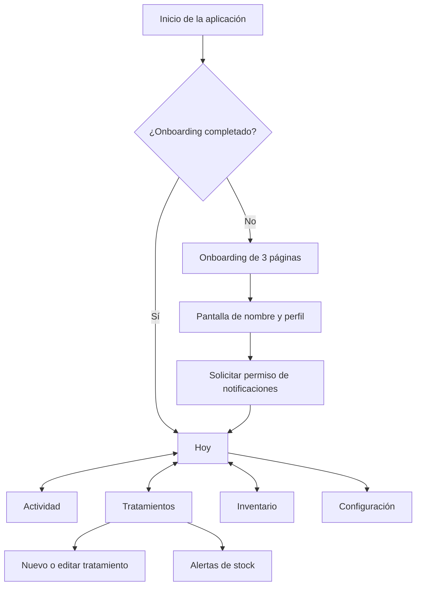
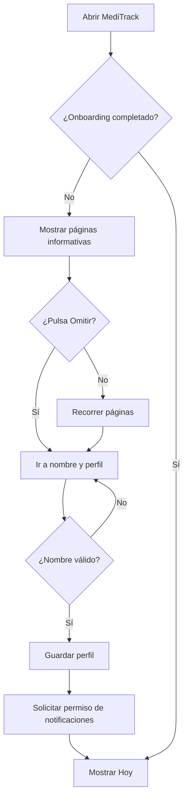
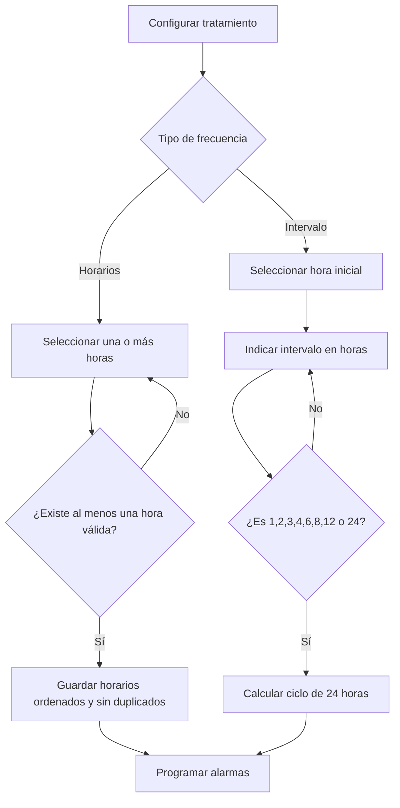
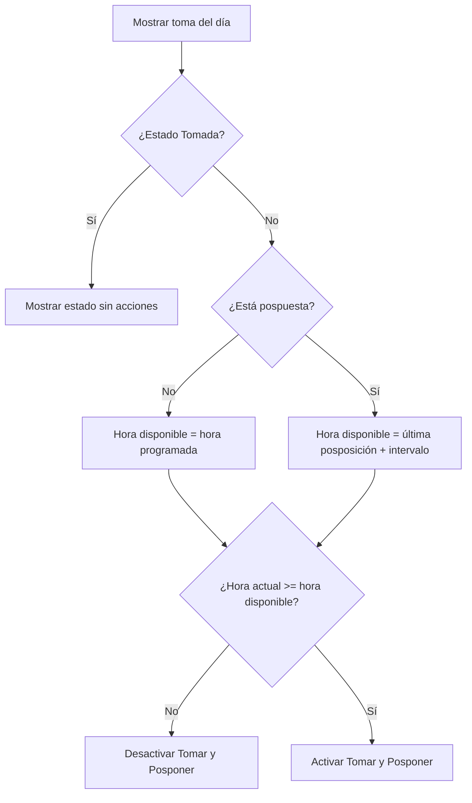
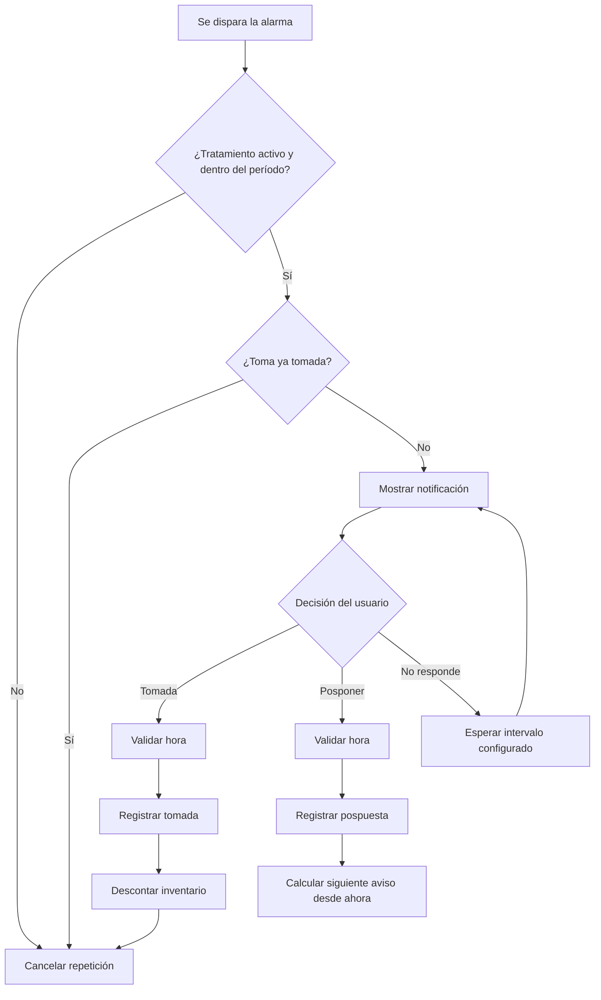
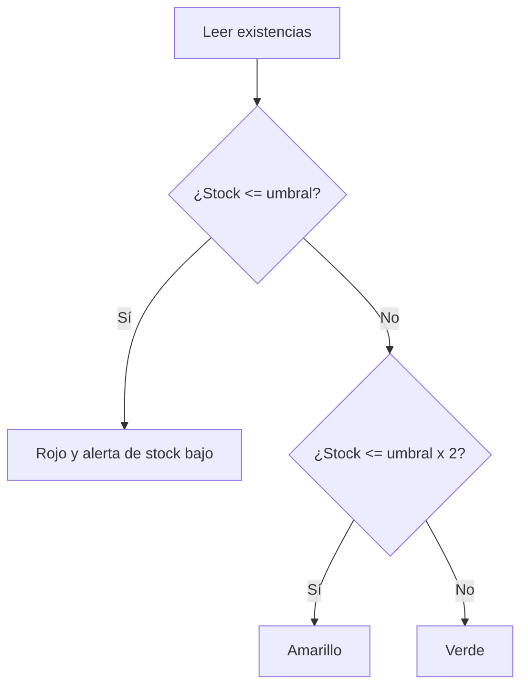
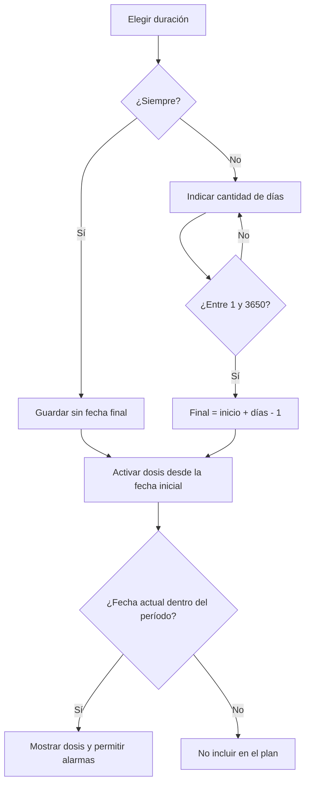

# Documentación funcional y base Scrum — MediTrack

**Versión documentada:** 1.1  
**Plataforma:** Android 7.0 o superior  
**Tecnología:** Kotlin, Jetpack Compose, Material 3 y Room  
**Fecha de revisión:** 8 de octubre de 2026  
**Estado:** descripción de la aplicación implementada actualmente

---

## 1. Propósito del documento

Este documento explica qué hace MediTrack, cómo interactúa el usuario con cada pantalla, qué reglas de negocio aplica el sistema y cómo puede organizarse el producto mediante la metodología ágil Scrum.

Puede utilizarse como:

- Contexto funcional para redactar un informe académico.
- Base para crear el Product Backlog.
- Fuente para historias de usuario y criterios de aceptación.
- Guía para demostraciones, pruebas y defensa del proyecto.
- Entrada para otra herramienta de inteligencia artificial sin que esta tenga que interpretar el código fuente.

> Importante: se diferencia entre las funciones que ya existen y las posibles mejoras futuras. Las funciones descritas en las secciones 4 a 16 corresponden al comportamiento actual de la aplicación.

---

## 2. Visión del producto

### 2.1 Problema

Las personas que toman medicinas o suplementos pueden olvidar una dosis, confundir sus horarios, perder el control de sus existencias o no tener una forma clara de comprobar su cumplimiento. Esto resulta especialmente relevante para pacientes crónicos, deportistas y usuarios con tratamientos temporales.

### 2.2 Solución

MediTrack es una aplicación móvil que concentra en un mismo lugar:

- La creación y organización de tratamientos.
- La agenda diaria de tomas.
- Los recordatorios locales y repetitivos.
- El registro de tomas realizadas o pospuestas.
- El inventario de pastillas.
- Las alertas de inventario medio, bajo o agotado.
- El dashboard y el historial de actividad.
- La personalización del nombre y el color de la interfaz.

### 2.3 Propuesta de valor

> “Ayudar al usuario a cumplir su rutina de medicación o suplementación mediante una agenda sencilla, recordatorios insistentes, control de inventario y visualización de progreso, incluso sin conexión a internet”.

### 2.4 Objetivo general

Desarrollar una aplicación Android accesible y adaptable que permita gestionar tratamientos y apoyar el cumplimiento de las tomas programadas.

### 2.5 Objetivos específicos

1. Registrar medicinas y suplementos con horarios configurables.
2. Mostrar las tomas del día y mantener las atrasadas hasta que cumplan 24 horas.
3. Evitar que una toma sea confirmada antes de su hora programada.
4. Repetir las alertas mientras una toma no haya sido confirmada.
5. Controlar el inventario y advertir sobre existencias bajas.
6. Mostrar métricas e historial para consultar el cumplimiento.
7. Mantener una interfaz responsive, compatible con letras grandes y personalizable por color.

---

## 3. Alcance, actores y perfiles

### 3.1 Alcance incluido

- Uso individual en un dispositivo Android.
- Persistencia local de tratamientos, inventario e historial.
- Funcionamiento sin conexión para los datos y recordatorios.
- Notificaciones locales del sistema Android.
- Configuración de horarios específicos o intervalos de horas.
- Tratamientos permanentes o con duración limitada.
- Control manual de reposiciones de inventario.
- Reporte mensual o entre fechas.

### 3.2 Fuera del alcance actual

- Registro de cuentas o inicio de sesión.
- Sincronización en la nube o entre dispositivos.
- Envío de notificaciones desde un servidor; las notificaciones actuales son locales, no push remotas.
- Perfiles múltiples en el mismo dispositivo.
- Comunicación con médicos, farmacias o familiares.
- Escaneo de recetas o códigos de barras.
- Exportación del reporte a PDF o Excel.
- Registro independiente de cada movimiento de inventario.
- Cálculo clínico o recomendación de dosis.

### 3.3 Actor principal

**Usuario de MediTrack:** persona que administra sus propias medicinas o suplementos.

### 3.4 Perfiles seleccionables durante el onboarding

| Perfil | Finalidad | Efecto actual |
| --- | --- | --- |
| Paciente crónico | Seguimiento continuo de medicamentos | El formulario nuevo inicia con la categoría Medicina seleccionada. |
| Deportista | Organización de suplementos y rutinas | El formulario nuevo inicia con la categoría Suplemento seleccionada. |
| Uso general | Tratamientos temporales o cuidado diario | El formulario nuevo inicia con la categoría Medicina seleccionada. |

El perfil sirve para personalizar el contexto inicial. No restringe funciones: cualquier usuario puede crear tanto medicinas como suplementos.

---

## 4. Mapa de navegación

La navegación principal tiene cuatro destinos:

| Destino | Propósito |
| --- | --- |
| Hoy | Consultar y gestionar el plan de tomas del día. |
| Actividad | Alternar entre Dashboard e Historial. |
| Tratamientos | Crear, consultar, editar o eliminar tratamientos y abrir alertas. |
| Inventario | Consultar existencias y agregar pastillas. |

Las pantallas secundarias son Configuración, Alertas y Nuevo/Editar tratamiento.



### 4.1 Comportamiento responsive

- En celulares se utiliza una barra inferior fija.
- En pantallas de 700 dp o más se utiliza una barra lateral.
- El contenido principal es desplazable; el menú de navegación permanece fijo.
- Las listas incluyen espacio inferior para que la barra no cubra el contenido.
- Las tarjetas del Plan de hoy cambian su distribución cuando el tamaño de fuente del sistema es grande.
- El dashboard reorganiza filtros y métricas entre filas y columnas según el ancho disponible.

---

## 5. Módulo de bienvenida y perfil inicial

### 5.1 Lanzamiento

La aplicación utiliza el launcher nativo de Android con el ícono de MediTrack. No existe una pantalla splash personalizada adicional.

### 5.2 Onboarding

Se presenta solamente cuando el usuario aún no ha completado la configuración inicial. Contiene tres páginas:

1. **Tus tratamientos, en orden:** explica la organización de medicinas, suplementos, dosis, horarios e inventario.
2. **Recordatorios que insisten:** explica que una toma pendiente puede generar recordatorios repetidos.
3. **Conoce tu progreso:** presenta el seguimiento del cumplimiento, las tomas pospuestas y el inventario.

Cada página permite avanzar o regresar. El progreso se representa mediante cuatro indicadores, incluyendo la configuración del perfil.

### 5.3 Omitir

- El botón **Omitir** aparece debajo de los indicadores mientras el usuario se encuentra en las tres páginas informativas.
- Omitir no entra directamente a la pantalla principal.
- Lleva a la pantalla de nombre y tipo de usuario, porque esos datos son necesarios para finalizar el onboarding.
- Su color sigue el tema activo de la aplicación.

### 5.4 Configuración del perfil

El usuario debe:

1. Introducir un nombre no vacío.
2. Seleccionar Paciente crónico, Deportista o Uso general.
3. Pulsar **Comenzar**.

Al completar el onboarding, la preferencia queda guardada localmente y no vuelve a mostrarse después de cerrar o reinstalar una actualización sobre la misma instalación. Si se eliminan todos los datos de la app o se desinstala completamente, el onboarding deberá mostrarse nuevamente en la siguiente instalación.

### 5.5 Permiso de notificaciones

En Android 13 o superior, después de completar el onboarding la aplicación solicita permiso para enviar notificaciones. Si el permiso no se concede, los tratamientos pueden guardarse y gestionarse, pero Android no mostrará sus alertas visuales.

---

## 6. Pantalla Hoy: plan diario

### 6.1 Encabezado

La pantalla muestra un saludo según la hora local:

| Hora | Saludo |
| --- | --- |
| 05:00–11:59 | Buenos días |
| 12:00–18:59 | Buenas tardes |
| 19:00–04:59 | Buenas noches |

El saludo incorpora el nombre guardado, por ejemplo: **“Buenas tardes, Kristel”**. A la derecha aparece un botón de configuración.

### 6.2 Resumen del día

- **Cumplimiento de hoy:** cantidad de tomas marcadas como tomadas sobre el total programado para hoy.
- **Próxima dosis:** primera toma cuyo estado continúa pendiente.
- **Inventario:** en móvil solo aparece cuando existe al menos un tratamiento con stock bajo; en pantalla amplia siempre se muestra.

### 6.3 Plan de hoy

Se generan tarjetas para tratamientos que:

- Estén activos.
- Hayan iniciado.
- No hayan superado su fecha final, si son temporales.
- Tengan un horario del día actual o una toma pendiente de ayer con menos de 24 horas.

Cada tarjeta contiene:

- Hora programada.
- Estado: Pendiente, Tomada, Pospuesta o No tomada.
- Ícono y color identificador.
- Nombre del tratamiento.
- Cantidad de pastillas por toma.
- Período, únicamente si el tratamiento tiene duración limitada.
- Indicaciones, cuando fueron registradas.
- Acción **Marcar como tomada**.
- Acción **Recordar en N minutos**.

### 6.4 Disponibilidad de acciones

- Antes de la hora programada, **Marcar como tomada** y **Recordar en N minutos** permanecen desactivados.
- La tarjeta indica a partir de qué hora estarán disponibles.
- Al alcanzar la hora, se habilitan automáticamente sin que sea necesario recargar la pantalla.
- Existe un segundo control en la capa de datos: incluso si la interfaz estuviera desactualizada, la aplicación rechaza una confirmación anticipada.
- El mismo control se aplica a acciones procedentes de notificaciones antiguas y a dobles pulsaciones.
- Si el inventario está en cero, ambas acciones y las notificaciones quedan suspendidas hasta una reposición.
- Una toma pendiente permanece disponible como máximo 24 horas desde su horario original; después cambia a No tomada, desaparece del Plan y permanece en el historial.

### 6.5 Marcar como tomada

Cuando el usuario confirma la toma:

1. Se registra el estado **Tomada**.
2. Se guarda la hora en la que se realizó la acción.
3. Se descuentan del inventario las pastillas configuradas por toma.
4. Se cancela la repetición de la alarma para esa toma.
5. Se retira su notificación activa.
6. La tarjeta se mantiene en el Plan de hoy con estado Tomada.

Marcar una toma no elimina ni desactiva el tratamiento.

### 6.6 Posponer

Cuando el usuario pulsa **Recordar en N minutos**:

1. Se registra el estado **Pospuesta**.
2. El nuevo momento se calcula desde el instante exacto de la pulsación.
3. Se programa una nueva alarma después del intervalo configurado.
4. Las acciones vuelven a bloquearse hasta alcanzar esa nueva hora.
5. La tarjeta muestra “Disponible nuevamente a las HH:mm”.

Si vuelve a posponer cuando llega el siguiente aviso, el tiempo se recalcula nuevamente desde esa última acción.

### 6.7 Estado vacío

Si no hay tratamientos activos para el día, aparece un mensaje indicando que el día está libre y que los tratamientos se agregan desde la pantalla Tratamientos.

---

## 7. Gestión de tratamientos

### 7.1 Lista de tratamientos

La pantalla Tratamientos muestra:

- Cantidad de tratamientos activos.
- Cantidad con inventario que requiere atención.
- Campana con insignia numérica cuando existen alertas de inventario.
- Separadores por categoría: **Medicinas** y **Suplementos**.
- Nombre, cantidad por toma, frecuencia, período limitado y estado pausado de cada elemento.
- Acciones para editar y eliminar.
- Botón flotante **Nuevo** para crear un tratamiento.
- Botones **Activos** e **Inactivos** para separar tratamientos vigentes de los cancelados.

No se puede reponer inventario desde esta pantalla.

### 7.2 Creación y edición

El formulario se divide en las siguientes secciones.

#### A. Información del medicamento

- Nombre obligatorio.
- Categoría Medicina o Suplemento.
- Indicaciones opcionales, por ejemplo “Tomar después de comer”.

#### B. Dosis

- Único campo: **Cantidad de pastillas por toma**.
- Solo acepta números enteros positivos.
- No solicita miligramos, gramos ni otra unidad clínica.

#### C. Horario y recordatorios

Existen dos formas excluyentes de programar el tratamiento:

**Horarios específicos**

- El usuario agrega una o varias horas mediante un selector de hora de 24 horas.
- Cada hora se muestra como una etiqueta.
- Al pulsar la etiqueta puede eliminarse.
- No se guardan horas duplicadas.

**Intervalo**

- El usuario selecciona una hora inicial.
- Indica cada cuántas horas se repite.
- Valores permitidos: 1, 2, 3, 4, 6, 8, 12 o 24 horas.
- La aplicación calcula y muestra todos los horarios de un ciclo de 24 horas.
- Ejemplo: inicio 08:00 y repetición cada 4 horas produce 00:00, 04:00, 08:00, 12:00, 16:00 y 20:00.

**Repetición de alarma**

- El usuario define cuántos minutos deben pasar antes de volver a avisar si la toma no se confirma.
- Rango válido: 1 a 1440 minutos.
- El valor se configura independientemente para cada tratamiento.

#### D. Duración

- **Siempre:** no tiene fecha final.
- **Por días:** solicita entre 1 y 3650 días.
- En ambos casos se selecciona la fecha inicial mediante un calendario.
- Para duración limitada se calcula y muestra un resumen con fecha inicial y final.
- El día inicial cuenta como el primer día; por ejemplo, un tratamiento de 3 días incluye inicio, segundo día y tercer día.

#### E. Inventario inicial

- Cantidad inicial de píldoras.
- Se acepta cero o un entero positivo.
- El umbral de stock bajo se calcula al guardar como el 20 % de la cantidad introducida, con un mínimo de 1.

#### F. Identificación y estado

- Color visual para distinguir el tratamiento.
- Interruptor **Tratamiento activo**.
- Un tratamiento pausado se conserva, pero no genera dosis en la agenda ni nuevas alarmas.
- Al cancelar un tratamiento desde Editar, se cancelan sus alarmas y se conserva todo su historial; pasa a la vista Inactivos.

### 7.3 Guardado

El formulario solo se guarda si:

- El nombre no está vacío.
- La cantidad por toma es mayor que cero.
- Existe al menos un horario válido.
- El inventario es numérico.
- El intervalo de recordatorio está entre 1 y 1440 minutos.
- El intervalo por horas pertenece a la lista permitida, cuando se usa esa modalidad.
- La duración está entre 1 y 3650 días, cuando es limitada.

Al editar un tratamiento, sus alarmas anteriores se cancelan y se programan nuevamente con la información actualizada.

### 7.4 Eliminación

- Solicita confirmación.
- Elimina el tratamiento.
- Elimina también todos sus registros del historial.
- Cancela sus alarmas.
- Es una operación irreversible desde la aplicación.

---

## 8. Recordatorios y notificaciones

### 8.1 Naturaleza de los recordatorios

Son notificaciones locales generadas por Android. No necesitan conexión a internet ni un servidor externo.

### 8.2 Contenido

- Título: “Es hora de tu medicamento”.
- Nombre del tratamiento.
- Cantidad de pastillas.
- Vibración y prioridad alta.
- Acción **Tomada**.
- Acción **Posponer**.
- Pulsar el cuerpo abre la aplicación.

### 8.3 Ciclo de repetición

1. Llega la hora programada.
2. Android muestra la notificación.
3. Si la toma no está resuelta, se agenda otra notificación para después de N minutos.
4. El ciclo continúa mientras el estado sea Pendiente o Pospuesta.
5. Al marcar Tomada se cancela el ciclo.

### 8.4 Posposición desde la notificación

La nueva alarma se calcula desde el instante en que el usuario pulsa Posponer, no desde la hora original. La capa interna comprueba que la toma ya esté disponible antes de aceptar la acción.

### 8.5 Reinicio y actualización de la app

Después de reiniciar el dispositivo o actualizar/reemplazar la aplicación:

- Se vuelven a programar los tratamientos activos.
- Se comprueban las tomas de hoy cuya hora ya pasó.
- Si una toma sigue sin resolverse, se reanuda su recordatorio.

### 8.6 Condiciones que impiden una alerta

- Tratamiento pausado.
- Fecha anterior al inicio.
- Fecha posterior al final del tratamiento.
- Toma ya marcada como Tomada.
- Permiso de notificaciones rechazado en versiones de Android que lo exigen.
- Restricciones del fabricante o del sistema sobre alarmas exactas.

---

## 9. Inventario

### 9.1 Resumen

La cabecera indica cuántos tratamientos tienen inventario medio, bajo o agotado respecto del total registrado, por ejemplo “2 de 5 tratamientos requieren atención”.

### 9.2 Organización

Los elementos se agrupan mediante separadores de Medicinas y Suplementos. Cada tarjeta muestra:

- Ícono y color del tratamiento.
- Nombre.
- Cantidad de pastillas por toma.
- Existencias actuales junto al ícono/contenido principal.
- Barra de nivel.
- Botón **Agregar**.

### 9.3 Colores de nivel

| Condición | Color |
| --- | --- |
| Stock menor o igual al umbral | Rojo |
| Stock mayor al umbral y menor o igual al doble del umbral | Amarillo |
| Stock superior al doble del umbral | Verde |

Estos colores comunican el nivel de manera visual; no aparecen rótulos como “existencias suficientes”.

### 9.4 Agregar existencias

1. El usuario pulsa **Agregar**.
2. Se abre un formulario que solicita cuántas píldoras desea incorporar.
3. Solo se acepta un entero mayor que cero.
4. La cantidad se suma a las existencias actuales.
5. El tratamiento no se modifica ni pierde sus tomas o historial.
6. Si estaba agotado, se cierra el período sin stock y sus alarmas activas vuelven a programarse.

### 9.5 Descuento automático

Cuando una toma se marca como tomada, se descuenta la cantidad de pastillas por toma. El inventario nunca baja de cero.

---

## 10. Alertas de stock

### 10.1 Acceso

Se accede mediante la campana ubicada en Tratamientos. La insignia muestra la cantidad de tratamientos activos cuyo inventario alcanzó el umbral bajo.

### 10.2 Contenido

- Resumen con número de alertas.
- Alertas de stock medio, bajo y agotado.
- Nombre del tratamiento.
- Existencias restantes.
- Umbral que activó la alerta.
- Botón **Recibido**, que confirma la lectura y oculta ese nivel hasta que el nivel cambie nuevamente.

No se muestran tomas pendientes en este centro de alertas.

### 10.3 Estado vacío

Si no existen alertas nuevas de inventario, se muestra “Todo está al día”.

---

## 11. Actividad: Dashboard e Historial

La pantalla Actividad tiene dos botones del mismo tamaño que funcionan como pestañas: **Dashboard** e **Historial**.

### 11.1 Dashboard

#### Filtros

- Por tratamiento: todos o uno específico.
- Por rango de fechas: fecha inicial y final.
- Sin rango personalizado, se utiliza desde el primer día del mes actual hasta el momento presente.
- Puede regresarse al mes actual con una acción explícita.

#### Métricas

- Porcentaje de cumplimiento.
- Total de dosis tomadas.
- Total de dosis actualmente pospuestas.
- Tratamientos activos.
- Dosis registradas en el período.
- Medicamentos con stock bajo.

#### Fórmula actual de cumplimiento

```text
cumplimiento = tomadas / (tomadas + pospuestas + no tomadas) × 100
```

Si no existen registros tomados o pospuestos, el cumplimiento es 0 %.

#### Período de tratamientos

Para cada tratamiento se muestra:

- Fecha de inicio.
- Fecha de finalización si es temporal.
- “Sin fecha de finalización” si es permanente.

Esta indicación de permanencia aparece en el reporte, pero no se agrega como rótulo a la vista principal ni a la lista de tratamientos.

### 11.2 Historial

Permite filtrar por:

- Todas.
- Tomadas.
- Pospuestas.
- No tomadas.
- Períodos sin stock.

Cada registro muestra nombre, cantidad por toma, fecha, hora programada y estado.

### 11.3 Interpretación del historial

- Existe un único registro por tratamiento y hora programada.
- Posponer deja la toma en estado Pospuesta.
- Si luego se marca como tomada, el mismo registro pasa a Tomada.
- Por tanto, el historial representa el estado final vigente de cada toma, no una bitácora separada de cada pulsación de Posponer.
- La opción Omitida no se presenta en la interfaz.
- Una toma pendiente o pospuesta pasa a No tomada al completar 24 horas desde su horario original.
- El encabezado contabiliza cuántas tomas no se realizaron.
- Cada período sin stock muestra fecha y hora de inicio, fecha y hora de fin —o reposición pendiente— y duración.

---

## 12. Configuración y personalización

### 12.1 Nombre

- Se abre desde el ícono junto al saludo.
- Permite cambiar el nombre del usuario.
- No acepta un nombre vacío.
- El nuevo nombre se refleja en el saludo de Hoy.

### 12.2 Temas

Paletas disponibles:

- Rosado.
- Morado.
- Azul.
- Verde.
- Rojo.
- Naranja.
- Turquesa.

El cambio se aplica de inmediato a fondos, botones, textos destacados, íconos, indicadores, controles y demás elementos que utilizan el tema de la aplicación. La elección se conserva localmente.

Los tratamientos disponen además de siete colores independientes —rosado, morado, azul, verde, rojo, naranja y turquesa—. El color del tratamiento no cambia al modificar el tema general.

El ícono del launcher es un recurso nativo estático; Android no recolorea automáticamente el ícono instalado al cambiar el tema interno.

---

## 13. Reglas de negocio

| ID | Regla |
| --- | --- |
| RN-01 | Solo los tratamientos activos generan tomas y alarmas. |
| RN-02 | Una toma pertenece al día calculado con la fecha y zona horaria local del dispositivo. |
| RN-03 | Una toma no puede marcarse ni posponerse antes de su hora disponible. |
| RN-04 | Una toma pospuesta vuelve a estar disponible al sumar el intervalo de minutos a la última posposición. |
| RN-05 | Marcar como tomada descuenta del inventario la cantidad configurada por toma. |
| RN-06 | El inventario no puede quedar por debajo de cero. |
| RN-07 | Reponer inventario suma una cantidad positiva al valor existente. |
| RN-08 | El stock bajo se activa cuando existencias ≤ umbral. |
| RN-09 | El umbral se calcula al guardar como máximo entre 1 y el 20 % entero del stock introducido. |
| RN-10 | Los intervalos por horas válidos son 1, 2, 3, 4, 6, 8, 12 o 24. |
| RN-11 | La repetición de alarma admite de 1 a 1440 minutos. |
| RN-12 | La duración limitada admite de 1 a 3650 días. |
| RN-13 | Un tratamiento permanente tiene duración interna igual a cero y no posee fecha final. |
| RN-14 | Eliminar un tratamiento elimina también su historial y cancela sus alarmas. |
| RN-15 | El Plan de hoy no permite crear tratamientos; estos se crean exclusivamente desde Tratamientos. |
| RN-16 | Las categorías solo son Medicina o Suplemento. |
| RN-17 | El usuario debe completar nombre y perfil para finalizar el onboarding. |
| RN-18 | Los recordatorios son locales y dependen de los permisos y capacidades del sistema Android. |
| RN-19 | El Dashboard ignora registros Omitidos y la interfaz solo utiliza Tomada y Pospuesta. |
| RN-20 | Un tratamiento fuera de su período no aparece en el Plan de hoy ni genera nuevas alertas. |
| RN-21 | Una toma sin resolver cambia a No tomada al completar 24 horas desde su horario original. |
| RN-22 | El inventario en cero suspende las alarmas y bloquea la confirmación hasta que exista una reposición. |
| RN-23 | Cada transición hacia stock cero abre un período sin existencias y la reposición lo cierra. |
| RN-24 | Recibido oculta la alerta del nivel actual; un cambio de nivel genera una alerta nueva. |
| RN-25 | Cancelar un tratamiento conserva sus registros, pero cancela sus alarmas y lo mueve a Inactivos. |
| RN-26 | Los colores identificadores del tratamiento son independientes del tema general. |

---

## 14. Flujos de interacción

### 14.1 Flujo de primera ejecución

1. El usuario abre MediTrack.
2. Observa la primera página del onboarding.
3. Puede recorrer las tres páginas o pulsar Omitir.
4. Llega a Personaliza MediTrack.
5. Introduce su nombre.
6. Selecciona su perfil.
7. Pulsa Comenzar.
8. Android solicita permiso de notificaciones cuando corresponde.
9. Entra a Hoy.
10. Como todavía no hay tratamientos, observa el estado vacío.

### 14.2 Flujo para crear el primer tratamiento

1. Entrar a Tratamientos desde el menú principal.
2. Pulsar Nuevo.
3. Escribir el nombre.
4. Elegir Medicina o Suplemento.
5. Añadir indicaciones opcionales.
6. Indicar pastillas por toma.
7. Elegir Horarios o Intervalo.
8. Seleccionar una hora mediante el componente de hora.
9. Configurar minutos de repetición de alarma.
10. Elegir Siempre o Por días.
11. Elegir fecha inicial y, si aplica, duración.
12. Indicar inventario inicial.
13. Elegir color.
14. Confirmar que el tratamiento esté activo.
15. Guardar.
16. La aplicación agenda las alarmas y regresa a Tratamientos.

### 14.3 Flujo normal de una toma

1. La toma aparece desde el comienzo del día.
2. Antes de la hora, las acciones están bloqueadas.
3. Al llegar la hora, se muestra una notificación y se habilitan las acciones.
4. El usuario marca la toma desde la notificación o desde Hoy.
5. El sistema valida nuevamente que la hora ya se cumplió.
6. Registra Tomada, descuenta inventario y detiene recordatorios.
7. El dashboard y el historial se actualizan.

### 14.4 Flujo de una toma pospuesta

1. Llega la hora programada.
2. El usuario pulsa Posponer o Recordar en N minutos.
3. El sistema registra la hora exacta de la acción.
4. Calcula `nueva hora = hora de la acción + N minutos`.
5. Bloquea temporalmente las acciones.
6. Al cumplirse la nueva hora, envía otra notificación y habilita las acciones.
7. El usuario puede volver a posponer o marcar tomada.

### 14.5 Flujo de stock bajo

1. Una toma confirmada descuenta pastillas.
2. El stock alcanza o baja del umbral.
3. La tarjeta de inventario cambia a rojo.
4. La campana de Tratamientos muestra una insignia.
5. El Centro de alertas incorpora el tratamiento.
6. El usuario abre Inventario y pulsa Agregar.
7. Introduce una cantidad positiva.
8. El sistema suma las pastillas y recalcula el color/alerta.

---

## 15. Árboles de decisión

### 15.1 Entrada a la aplicación



### 15.2 Programación de horario



### 15.3 Disponibilidad de una toma



### 15.4 Respuesta a una alarma



### 15.5 Nivel de inventario



### 15.6 Duración del tratamiento



---

## 16. Modelo conceptual de datos

### 16.1 Tratamiento

| Campo conceptual | Descripción |
| --- | --- |
| Identificador | Clave única del tratamiento. |
| Nombre | Nombre de la medicina o suplemento. |
| Pastillas por toma | Cantidad descontada en cada confirmación. |
| Categoría | Medicina o Suplemento. |
| Indicaciones | Texto opcional. |
| Horarios | Lista de horas o una hora base para el intervalo. |
| Intervalo de dosis | Frecuencia en horas; cero representa horarios específicos. |
| Intervalo de recordatorio | Minutos antes de repetir una alarma pendiente. |
| Inicio | Primer día válido. |
| Duración | Cero para permanente o número de días para temporal. |
| Stock | Existencias actuales. |
| Umbral bajo | Nivel que activa la alerta roja. |
| Color | Índice visual del tratamiento. |
| Activo | Define si participa en agenda y alarmas. |

### 16.2 Registro de toma

| Campo conceptual | Descripción |
| --- | --- |
| Identificador | Clave única del registro. |
| Tratamiento | Relación lógica con el tratamiento. |
| Hora programada | Fecha y hora de la toma original. |
| Estado | Pendiente, Tomada, Pospuesta o No tomada en la experiencia actual. |
| Hora de acción | Momento de la última confirmación o posposición. |

### 16.3 Preferencias

- Nombre.
- Perfil de uso.
- Onboarding completado.
- Tema seleccionado.
- Lista heredada de unidades personalizadas; ya no se usa en el formulario actual de dosis.

### 16.4 Persistencia

- Tratamientos y tomas: base de datos Room `meditrack.db`.
- Perfil y tema: preferencias locales de Android.
- La información permanece al cerrar la app.
- Desinstalar o borrar datos elimina la información local.

---

## 17. Modelo ágil codificado y Product Backlog

Esta sección conserva las historias y los tres releases del tablero original, pero los combina con el alcance vigente de la aplicación. Para impedir que dos elementos diferentes compartan el mismo identificador, las historias antiguas se registran como referencias `LEG-HU` y se relacionan con una única historia canónica `HU`.

### 17.1 Convención de codificación

| Prefijo | Elemento | Ejemplo |
| --- | --- | --- |
| `OBJ` | Objetivo del Impact Mapping | `OBJ-01` |
| `ACT` | Actor | `ACT-01` |
| `IMP` | Impacto o cambio de conducta | `IMP-01` |
| `ENT` | Entregable | `ENT-01` |
| `EP` | Épica | `EP-01` |
| `HU` | Historia de usuario canónica | `HU-04` |
| `LEG-HU` | Código histórico conservado para trazabilidad | `LEG-HU-01` |
| `PBI` | Elemento priorizado del Product Backlog | `PBI-004` |
| `PRI` | Nivel de prioridad | `PRI-01` |
| `REL` | Release | `REL-01` |

Cada código es único dentro del documento. Los códigos históricos no se reutilizan como códigos canónicos.

### 17.2 Impact Mapping codificado

| Código | Tipo | Definición |
| --- | --- | --- |
| OBJ-01 | Objetivo | Lograr que al menos el 85 % de los usuarios activos confirmen sus tomas durante los primeros tres meses de uso. |
| ACT-01 | Actor | Paciente crónico, deportista o usuario general que utiliza MediTrack para gestionar medicinas o suplementos. |
| IMP-01 | Impacto | Registrar una toma a tiempo o posponerla de forma controlada. |
| IMP-02 | Impacto | Mantener inventario disponible y reponerlo antes o después de un agotamiento. |
| IMP-03 | Impacto | Consultar el cumplimiento y usar el historial para comprender su adherencia. |
| ENT-01 | Entregable | Plan diario con acciones bloqueadas antes de la hora programada. |
| ENT-02 | Entregable | Alarmas locales repetitivas que funcionan sin conexión. |
| ENT-03 | Entregable | Posposición con recálculo de la siguiente alarma. |
| ENT-04 | Entregable | Inventario visual con estados bueno, medio, bajo y agotado. |
| ENT-05 | Entregable | Centro de alertas de stock con confirmación `Recibido`. |
| ENT-06 | Entregable | Suspensión de alarmas en stock cero y reactivación después de reponer. |
| ENT-07 | Entregable | Dashboard e historial con filtros y períodos sin stock. |
| ENT-08 | Entregable | mi |
| ENT-09 | Entregable | Interfaz responsive, compatible con texto grande y personalizable. |

### 17.3 Épicas

| Código | Épica | Objetivo | Impactos relacionados |
| --- | --- | --- | --- |
| EP-01 | Incorporación y personalización | Preparar la experiencia inicial y adaptar la apariencia al usuario. | IMP-03 |
| EP-02 | Gestión de tratamientos | Crear y mantener medicinas y suplementos con horarios, frecuencia y duración. | IMP-01 |
| EP-03 | Agenda y cumplimiento | Gestionar las tomas del día y evitar registros anticipados. | IMP-01 |
| EP-04 | Recordatorios | Avisar, repetir, posponer, restaurar y cancelar alarmas oportunamente. | IMP-01, IMP-02 |
| EP-05 | Inventario y alertas | Controlar existencias y responder a los niveles medio, bajo y agotado. | IMP-02 |
| EP-06 | Analítica e historial | Consultar métricas, estados y eventos históricos. | IMP-03 |
| EP-07 | Accesibilidad y responsive | Adaptar la interfaz a dispositivos y configuraciones de texto grande. | IMP-01, IMP-02, IMP-03 |

### 17.4 Historias antiguas y correspondencia con la versión actual

| Código histórico | Historia conservada del tablero | Historia canónica actual |
| --- | --- | --- |
| LEG-HU-01 | Registrar un medicamento con dosis y horario en pocos pasos. | HU-04, HU-05 |
| LEG-HU-02 | Recibir alarmas nativas locales en el horario programado y sin internet. | HU-13, HU-15 |
| LEG-HU-03 | Confirmar una toma desde la alerta y descontar el stock. | HU-11, HU-14 |
| LEG-HU-04 | Visualizar el listado de tomas del día. | HU-09 |
| LEG-HU-05 | Posponer una alerta durante un tiempo determinado. | HU-12 |
| LEG-HU-06 | Recibir avisos cuando el inventario esté próximo a agotarse. | HU-16, HU-18, HU-24 |
| LEG-HU-07 | Recargar manualmente el inventario. | HU-17 |
| LEG-HU-08 | Consultar el historial semanal de tomas realizadas y no realizadas. | HU-21, HU-28 |
| LEG-HU-09 | Modificar o eliminar un tratamiento. | HU-08, HU-29 |
| LEG-HU-10 | Exportar un reporte para una cita médica. | HU-31 |
| LEG-HU-11 | Personalizar tonos y patrones de vibración. | HU-32 |
| LEG-HU-12 | Consultar un gráfico o resumen mensual de adherencia. | HU-19 |

La correspondencia evita duplicar funcionalidades. Por ejemplo, `LEG-HU-05` no se convierte en una segunda historia de posposición: queda trazada hacia `HU-12`, que contiene la regla vigente de recálculo.

### 17.5 Catálogo de prioridades

| Código | Prioridad | Regla de decisión |
| --- | --- | --- |
| PRI-01 | Alta | Función necesaria para crear tratamientos, recibir alarmas, registrar tomas, proteger la integridad de datos o impedir errores críticos. |
| PRI-02 | Media | Función de seguimiento, prevención o consulta que amplía un flujo principal ya operativo. |
| PRI-03 | Baja | Personalización o mejora complementaria que no impide completar el tratamiento. |

El orden de prioridad considera valor para el usuario, reducción de riesgo, aprendizaje esperado, esfuerzo y dependencia funcional. Las dependencias siempre se implementan antes que la historia que las consume.

### 17.6 Tabla de prioridad original y trazabilidad

La siguiente tabla conserva la evaluación mostrada en el backlog original. La escala utilizada es de 1 a 5, donde 5 representa el valor, riesgo o aprendizaje más alto. En esfuerzo, un número mayor representa mayor trabajo estimado. La columna canónica permite rastrear cada fila histórica hacia la versión vigente sin duplicar códigos.

| Código histórico | HU canónica | Valor | Riesgo | Aprendizaje | Esfuerzo | Prioridad histórica | Release conservado | Dependencia histórica | Situación actual |
| --- | --- | ---: | ---: | ---: | ---: | --- | --- | --- | --- |
| LEG-HU-01 | HU-04, HU-05 | 5 | 3 | 5 | 3 | PRI-01 | REL-01 | Ninguna | Integrada e implementada |
| LEG-HU-02 | HU-13, HU-15 | 5 | 5 | 5 | 3 | PRI-01 | REL-01 | LEG-HU-01 | Integrada e implementada |
| LEG-HU-03 | HU-11, HU-14 | 5 | 3 | 3 | 2 | PRI-01 | REL-01 | LEG-HU-02 | Integrada e implementada |
| LEG-HU-04 | HU-09 | 3 | 3 | 3 | 2 | PRI-01 | REL-01 | LEG-HU-01 | Integrada e implementada |
| LEG-HU-05 | HU-12 | 3 | 3 | 3 | 2 | PRI-02 | REL-02 | LEG-HU-02 | Ampliada con recálculo e implementada |
| LEG-HU-06 | HU-16, HU-18, HU-24 | 3 | 3 | 3 | 2 | PRI-02 | REL-02 | LEG-HU-03 | Dividida por niveles e implementada |
| LEG-HU-07 | HU-17 | 3 | 1 | 1 | 1 | PRI-02 | REL-02 | LEG-HU-01 | Ampliada con registro e implementada |
| LEG-HU-08 | HU-21, HU-28 | 3 | 1 | 3 | 3 | PRI-02 | REL-02 | LEG-HU-03 | Ampliada con filtros y regla de 24 horas |
| LEG-HU-09 | HU-08, HU-29 | 3 | 1 | 1 | 2 | PRI-02 | REL-02 | LEG-HU-01 | Ampliada con inactivación e implementada |
| LEG-HU-10 | HU-31 | 3 | 3 | 3 | 3 | PRI-02 | REL-03 | LEG-HU-08 | Conservada como mejora futura PRI-03 |
| LEG-HU-11 | HU-32 | 1 | 1 | 1 | 2 | PRI-03 | REL-03 | LEG-HU-02 | Conservada como mejora futura |
| LEG-HU-12 | HU-19 | 3 | 1 | 3 | 3 | PRI-03 | REL-03 | LEG-HU-08 | Integrada como dashboard e implementada |

### 17.7 Product Backlog combinado y priorizado

| PBI | HU | Historia de usuario resumida | Épica | Prioridad | Release | Estado |
| --- | --- | --- | --- | --- | --- | --- |
| PBI-001 | HU-01 | Conocer las funciones principales mediante el onboarding. | EP-01 | PRI-01 | REL-01 | Implementada |
| PBI-002 | HU-02 | Registrar nombre y finalidad de uso. | EP-01 | PRI-01 | REL-01 | Implementada |
| PBI-003 | HU-03 | Omitir el onboarding e ir al perfil. | EP-01 | PRI-02 | REL-03 | Implementada |
| PBI-004 | HU-04 | Crear una medicina o suplemento con cantidad de pastillas por toma. | EP-02 | PRI-01 | REL-01 | Implementada |
| PBI-005 | HU-05 | Elegir horarios mediante un selector. | EP-02 | PRI-01 | REL-01 | Implementada |
| PBI-006 | HU-06 | Programar un tratamiento por intervalos de horas. | EP-02 | PRI-01 | REL-02 | Implementada |
| PBI-007 | HU-07 | Definir un tratamiento permanente o por cantidad de días. | EP-02 | PRI-01 | REL-02 | Implementada |
| PBI-008 | HU-08 | Editar o eliminar un tratamiento. | EP-02 | PRI-01 | REL-02 | Implementada |
| PBI-009 | HU-09 | Consultar las tomas correspondientes al día. | EP-03 | PRI-01 | REL-01 | Implementada |
| PBI-010 | HU-10 | Bloquear Tomar y Posponer antes de la hora. | EP-03 | PRI-01 | REL-02 | Implementada |
| PBI-011 | HU-11 | Marcar una toma y descontar el inventario una sola vez. | EP-03 | PRI-01 | REL-01 | Implementada |
| PBI-012 | HU-12 | Posponer una toma y recalcular la siguiente alarma. | EP-03 | PRI-01 | REL-02 | Implementada |
| PBI-013 | HU-13 | Repetir los recordatorios hasta resolver la toma. | EP-04 | PRI-01 | REL-01 | Implementada |
| PBI-014 | HU-14 | Responder Tomada o Posponer desde la notificación. | EP-04 | PRI-01 | REL-01 | Implementada |
| PBI-015 | HU-15 | Restaurar alarmas después de reiniciar el dispositivo. | EP-04 | PRI-01 | REL-02 | Implementada |
| PBI-016 | HU-16 | Mostrar el nivel de inventario mediante colores. | EP-05 | PRI-01 | REL-02 | Implementada |
| PBI-017 | HU-17 | Agregar pastillas y conservar el registro de reposición. | EP-05 | PRI-01 | REL-02 | Implementada |
| PBI-018 | HU-18 | Consultar el centro de alertas de inventario. | EP-05 | PRI-02 | REL-02 | Implementada |
| PBI-019 | HU-19 | Consultar el cumplimiento mensual o entre fechas. | EP-06 | PRI-01 | REL-03 | Implementada |
| PBI-020 | HU-20 | Filtrar la actividad por tratamiento. | EP-06 | PRI-02 | REL-03 | Implementada |
| PBI-021 | HU-21 | Filtrar el historial por estado y períodos sin stock. | EP-06 | PRI-02 | REL-02 | Implementada |
| PBI-022 | HU-22 | Usar tarjetas y controles legibles con texto grande. | EP-07 | PRI-01 | REL-03 | Implementada |
| PBI-023 | HU-23 | Elegir uno de siete temas para toda la interfaz. | EP-01 | PRI-03 | REL-03 | Implementada |
| PBI-024 | HU-24 | Recibir alertas preventivas de stock medio. | EP-05 | PRI-02 | REL-02 | Implementada |
| PBI-025 | HU-25 | Confirmar una alerta de inventario como recibida. | EP-05 | PRI-02 | REL-02 | Implementada |
| PBI-026 | HU-26 | Pausar alarmas en stock cero y reactivarlas al reponer. | EP-04 | PRI-01 | REL-02 | Implementada |
| PBI-027 | HU-27 | Consultar las fechas y duración de un período sin stock. | EP-06 | PRI-02 | REL-03 | Implementada |
| PBI-028 | HU-28 | Registrar una toma como No tomada después de 24 horas. | EP-06 | PRI-01 | REL-02 | Implementada |
| PBI-029 | HU-29 | Inactivar un tratamiento, cancelar sus alarmas y conservar su historial. | EP-02 | PRI-01 | REL-02 | Implementada |
| PBI-030 | HU-30 | Consultar tratamientos separados por categoría y estado activo o inactivo. | EP-02 | PRI-01 | REL-01 | Implementada |
| PBI-031 | HU-31 | Exportar un reporte para compartirlo en una cita médica. | EP-06 | PRI-03 | REL-03 | Mejora futura |
| PBI-032 | HU-32 | Personalizar tonos y patrones de vibración de las alarmas. | EP-04 | PRI-03 | REL-03 | Mejora futura |
| PBI-033 | HU-33 | Asignar uno de siete colores independientes a cada tratamiento. | EP-01 | PRI-03 | REL-03 | Implementada |

### 17.8 Historias de usuario canónicas añadidas

Las historias `HU-01` a `HU-29` conservan su redacción detallada y sus criterios en esta documentación. Las siguientes completan la combinación con el tablero original y la versión actual:

| Código | Historia de usuario |
| --- | --- |
| HU-30 | Como usuario, quiero consultar mis tratamientos separados por categoría y por estado activo o inactivo para encontrarlos y administrarlos con rapidez. |
| HU-31 | Como usuario, quiero exportar un reporte de mi historial para compartir información de adherencia durante una cita médica. |
| HU-32 | Como usuario, quiero personalizar el sonido y la vibración de las alarmas para reconocer los recordatorios de MediTrack. |
| HU-33 | Como usuario, quiero elegir un color independiente para cada tratamiento para distinguirlo sin depender del tema general de la aplicación. |

`HU-31` y `HU-32` se conservan por solicitud del alcance original, pero permanecen identificadas como mejoras futuras para no afirmar que ya existen en la aplicación.

### 17.9 Hoja de ruta: releases originales actualizados

Se conservan los tres releases del tablero. La actualización amplía su contenido sin cambiar su propósito ni crear un cuarto release.

| Código | Nombre conservado | Definición actualizada | Historias canónicas incluidas |
| --- | --- | --- | --- |
| REL-01 | Release 1 — MVP | Permite incorporarse, consultar y registrar tratamientos, ver el plan diario, recibir alarmas locales y confirmar una toma con descuento de inventario. | HU-01, HU-02, HU-04, HU-05, HU-09, HU-11, HU-13, HU-14, HU-30 |
| REL-02 | Release 2 | Amplía el MVP con intervalos y duración, edición, bloqueo anticipado, posposición recalculada, recuperación de alarmas, inventario completo, alertas, reposición, No tomada, stock cero y tratamientos inactivos. | HU-06, HU-07, HU-08, HU-10, HU-12, HU-15, HU-16, HU-17, HU-18, HU-21, HU-24, HU-25, HU-26, HU-28, HU-29 |
| REL-03 | Release 3 | Consolida analítica, filtros, períodos sin stock, accesibilidad y personalización; conserva exportación y sonido/vibración como mejoras futuras del mismo release. | HU-03, HU-19, HU-20, HU-22, HU-23, HU-27, HU-31, HU-32, HU-33 |

#### REL-01 — Criterio de salida

- El usuario puede crear y consultar al menos un tratamiento.
- El plan del día genera las tomas correctas.
- La alarma funciona localmente y permite confirmar la toma.
- Confirmar descuenta el inventario exactamente una vez.

#### REL-02 — Criterio de salida

- Las tomas anticipadas están bloqueadas.
- Posponer recalcula el siguiente aviso.
- El inventario cambia de nivel, genera alertas y permite reposición.
- Llegar a cero suspende alarmas y reponerlas las reactiva.
- Las tomas no resueltas pasan a No tomada después de 24 horas.
- Inactivar conserva el historial y cancela las alarmas futuras.

#### REL-03 — Criterio de salida

- Dashboard e historial muestran información consistente y filtrable.
- Los períodos sin stock conservan fecha de inicio y fin.
- La interfaz responde correctamente con texto grande.
- El tema general y el color de tratamiento se aplican de forma independiente.
- Las historias futuras no se consideran terminadas hasta implementar y probar su comportamiento.

---

## 18. Criterios de aceptación principales

### HU-04 — Crear tratamiento

**Escenario exitoso**

- Dado que el usuario está en Tratamientos,
- cuando pulsa Nuevo, completa los campos obligatorios y guarda,
- entonces el tratamiento aparece en su categoría y se programan sus alarmas.

**Escenario inválido**

- Dado que falta un campo obligatorio o existe un valor fuera de rango,
- cuando el usuario intenta guardar,
- entonces el formulario permanece abierto y señala que debe corregirse.

### HU-06 — Frecuencia por intervalo

- Dado un intervalo permitido y una hora inicial,
- cuando el usuario configura el tratamiento,
- entonces el sistema presenta todos los horarios calculados dentro de 24 horas.

- Dado un intervalo que no divide correctamente el día según las opciones admitidas,
- cuando intenta guardar,
- entonces el sistema no permite completar el registro.

### HU-07 — Duración

- Dado un tratamiento de N días,
- cuando el usuario elige una fecha inicial,
- entonces la app muestra la fecha final inclusiva.

- Dado que la fecha actual está fuera del período,
- cuando se construye el Plan de hoy,
- entonces el tratamiento no genera tarjetas ni nuevas alarmas.

### HU-10 — Bloqueo anticipado

- Dada una toma futura,
- cuando el usuario abre Hoy antes de la hora,
- entonces Tomar y Posponer están desactivados.

- Dado un intento anticipado desde una interfaz desactualizada o notificación,
- cuando llega a la capa de datos,
- entonces el sistema lo rechaza y no descuenta inventario.

- Dado que la hora ya se alcanzó,
- cuando la pantalla permanece abierta,
- entonces las acciones se habilitan automáticamente.

### HU-11 — Confirmar toma

- Dada una toma disponible y pendiente,
- cuando el usuario pulsa Marcar como tomada,
- entonces cambia a Tomada, descuenta las pastillas una sola vez y cancela la repetición.

- Dada una toma ya tomada,
- cuando se intenta confirmar nuevamente,
- entonces no se produce un segundo descuento.

### HU-12 — Posponer

- Dada una toma disponible,
- cuando se pospone a las 10:03 con intervalo de 5 minutos,
- entonces la nueva disponibilidad es 10:08.

- Dada una toma pospuesta que todavía no alcanzó la nueva hora,
- cuando el usuario intenta marcarla,
- entonces la acción es rechazada.

### HU-13 — Recordatorio repetido

- Dada una toma pendiente,
- cuando pasa el intervalo configurado sin confirmación,
- entonces se emite un nuevo recordatorio.

- Dada una toma tomada,
- cuando llega el momento de una repetición previamente prevista,
- entonces no se muestra otra alerta.

### HU-16 — Colores de inventario

- Dado un stock igual o inferior al umbral, se muestra rojo.
- Dado un stock superior al umbral pero no mayor que su doble, se muestra amarillo.
- Dado un stock superior al doble del umbral, se muestra verde.

### HU-19 — Dashboard

- Dado que no se seleccionó un rango, cuando se abre Dashboard, entonces se utiliza el mes actual.
- Dado un rango completo, cuando se aplica, entonces solo se consideran tomas dentro de sus fechas inclusivas.
- Dado un tratamiento seleccionado, cuando se aplica el filtro, entonces las métricas consideran solo ese tratamiento.

---

## 19. Requisitos no funcionales

| ID | Requisito |
| --- | --- |
| RNF-01 | La aplicación debe funcionar en Android 7.0 (API 24) o posterior. |
| RNF-02 | Los datos esenciales y recordatorios deben funcionar sin internet. |
| RNF-03 | La navegación principal debe permanecer accesible mientras el contenido se desplaza. |
| RNF-04 | La interfaz debe adaptarse a celular, pantalla amplia y tamaño de letra grande. |
| RNF-05 | La información debe persistir después de cerrar la aplicación. |
| RNF-06 | Las operaciones de base de datos deben ejecutarse fuera del hilo visual. |
| RNF-07 | Las acciones destructivas deben requerir confirmación. |
| RNF-08 | Los campos numéricos deben validar tipo y rango antes de guardar. |
| RNF-09 | Los controles deben tener descripciones accesibles cuando corresponda. |
| RNF-10 | El tema seleccionado debe aplicarse de forma consistente y persistente. |

---

## 20. Organización Scrum sugerida

### 20.1 Roles

| Rol Scrum | Responsabilidad sugerida |
| --- | --- |
| Product Owner | Prioriza necesidades de usuarios, valida alcance y acepta incrementos. |
| Scrum Master | Facilita eventos, elimina impedimentos y protege la aplicación de Scrum. |
| Developers | Diseñan, implementan, prueban y documentan el incremento. |
| Stakeholders | Docente, usuarios de prueba, pacientes o deportistas consultados. |

En un proyecto académico una misma persona puede asumir varios roles, pero conviene documentar claramente cuándo actúa como Product Owner, Scrum Master o Developer.

### 20.2 Sprint Goal propuesto por iteración

| Sprint | Meta | Historias sugeridas |
| --- | --- | --- |
| Sprint 1 | Crear la base navegable y personalizar la entrada. | HU-01, HU-02, HU-03, HU-23 |
| Sprint 2 | Registrar y mantener tratamientos completos. | HU-04, HU-05, HU-06, HU-07, HU-08 |
| Sprint 3 | Gestionar el plan diario y la confirmación segura. | HU-09, HU-10, HU-11, HU-12 |
| Sprint 4 | Implementar recordatorios resistentes y repetitivos. | HU-13, HU-14, HU-15 |
| Sprint 5 | Incorporar inventario, niveles y alertas. | HU-16, HU-17, HU-18 |
| Sprint 6 | Analizar actividad y cerrar accesibilidad/documentación. | HU-19, HU-20, HU-21, HU-22 |

### 20.3 Eventos Scrum

- **Sprint Planning:** seleccionar historias según prioridad y capacidad, definir Sprint Goal y tareas técnicas.
- **Daily Scrum:** responder qué avance acerca al Sprint Goal, qué se hará después y qué impedimentos existen.
- **Sprint Review:** demostrar el incremento en un teléfono o emulador con escenarios reales.
- **Sprint Retrospective:** analizar qué funcionó, qué dificultó el trabajo y qué acción concreta mejorar en el siguiente Sprint.
- **Backlog Refinement:** aclarar reglas, dividir historias grandes, estimar y actualizar criterios de aceptación.

### 20.4 Definition of Ready sugerida

Una historia está lista para entrar a un Sprint cuando:

- Tiene valor claro para el usuario.
- Está redactada como rol, necesidad y beneficio.
- Posee criterios de aceptación verificables.
- Se conocen reglas de negocio y dependencias.
- El equipo puede estimarla.
- Es suficientemente pequeña para terminarse dentro del Sprint.

### 20.5 Definition of Done sugerida

Una historia se considera terminada cuando:

- Cumple todos sus criterios de aceptación.
- Compila sin errores.
- Tiene pruebas unitarias para la lógica crítica.
- Pasa análisis lint.
- Fue probada en al menos un dispositivo o emulador compatible.
- Funciona con texto grande cuando modifica interfaz.
- No rompe navegación, persistencia ni alarmas existentes.
- La documentación funcional y técnica relevante fue actualizada.
- El Product Owner acepta el resultado en la Sprint Review.

---

## 21. Casos de prueba de aceptación sugeridos

| ID | Caso | Resultado esperado |
| --- | --- | --- |
| CP-01 | Primera instalación | Aparece onboarding y luego perfil. |
| CP-02 | Pulsar Omitir | Abre nombre y perfil, no Hoy directamente. |
| CP-03 | Guardar sin nombre | Comenzar permanece deshabilitado. |
| CP-04 | Crear medicina con dos horarios | Aparece en Medicinas y en las horas del Plan de hoy si la fecha aplica. |
| CP-05 | Crear suplemento como deportista | Suplemento está preseleccionado. |
| CP-06 | Configurar cada 4 horas desde 08:00 | Se calculan seis horas dentro del día. |
| CP-07 | Configurar tratamiento de 3 días | Incluye exactamente inicio, segundo y tercer día. |
| CP-08 | Intentar tomar antes de la hora | Botón desactivado y capa interna rechaza el cambio. |
| CP-09 | Tomar a la hora | Cambia a Tomada y descuenta pastillas una vez. |
| CP-10 | Doble toque o notificación repetida | No duplica descuento. |
| CP-11 | Posponer 5 minutos | Nueva disponibilidad es cinco minutos desde la pulsación. |
| CP-12 | Intentar tomar durante posposición | Acción bloqueada y rechazada internamente. |
| CP-13 | No responder alerta | La notificación se repite según configuración. |
| CP-14 | Reiniciar dispositivo | Las alarmas activas se reprograman. |
| CP-15 | Alcanzar umbral de inventario | Nivel rojo, campana y centro de alertas se actualizan. |
| CP-16 | Agregar 20 pastillas | Se suman 20; no se reemplaza el valor ni se borra historial. |
| CP-17 | Cambiar tema | Toda la interfaz cambia y conserva la elección al reiniciar. |
| CP-18 | Cambiar nombre | El siguiente saludo usa el nombre nuevo. |
| CP-19 | Filtrar Dashboard entre fechas | Métricas se limitan al rango inclusivo. |
| CP-20 | Eliminar tratamiento | Desaparece tratamiento, historial asociado y alarmas. |
| CP-21 | Llegar a stock medio | Aparece una alerta amarilla en el centro de alertas. |
| CP-22 | Marcar alerta como Recibido | Se oculta hasta que cambie el nivel de inventario. |
| CP-23 | Llegar a cero | Se abre un período sin stock y dejan de mostrarse recordatorios de toma. |
| CP-24 | Reponer desde cero | Se cierra el período sin stock y se reprograman alarmas futuras. |
| CP-25 | Dejar una toma pendiente 24 horas | Desaparece del Plan y se registra como No tomada. |
| CP-26 | Cancelar tratamiento | Aparece en Inactivos, cancela alarmas y conserva historial. |

---

## 22. Riesgos, supuestos y limitaciones

### 22.1 Riesgos

- Algunos fabricantes limitan alarmas en segundo plano para ahorrar batería.
- Rechazar permisos impide visualizar notificaciones.
- Cambiar manualmente la fecha, hora o zona horaria puede afectar la programación.
- Al ser almacenamiento local, perder o cambiar de dispositivo elimina los datos si no existe respaldo.
- El umbral automático puede no coincidir con la preferencia particular de todos los usuarios.

### 22.2 Supuestos

- El usuario administra un único perfil.
- La hora del dispositivo es correcta.
- La cantidad por toma se expresa en pastillas enteras.
- El usuario confirma una toma solo cuando realmente la realizó.
- Un día de tratamiento se interpreta con el calendario local del dispositivo.

### 22.3 Limitaciones conocidas de interpretación

- El Dashboard mide estados finales: una toma que primero fue pospuesta y luego tomada cuenta finalmente como Tomada.
- El historial muestra la hora programada, no una lista completa de cada alerta o posposición.
- Las reposiciones modifican el saldo, pero no existe una bitácora individual de movimientos.
- El ícono instalado de Android no cambia con el tema interno.
- MediTrack es una herramienta de organización y no reemplaza la orientación de un profesional de salud.

---

## 23. Mejoras futuras candidatas para el backlog

Estas opciones no deben presentarse como implementadas:

1. Historial de cada evento de posposición y cada reposición.
2. Umbral de stock configurable manualmente.
3. Exportación de reportes a PDF o Excel.
4. Copia de seguridad y sincronización segura.
5. Perfiles de cuidador y paciente.
6. Confirmación biométrica o PIN para acciones sensibles.
7. Estadísticas por semana, rachas y tendencias.
8. Modo oscuro.
9. Fracciones de pastilla por toma.
10. Recordatorios de compra antes de llegar al nivel rojo.
11. Registro de motivo al posponer.
12. Pruebas instrumentadas completas de interfaz y notificaciones.

---

## 24. Prompt listo para solicitar documentación Scrum a otra IA

Puedes copiar el texto siguiente y adjuntar este archivo:

> Actúa como analista de requisitos, Product Owner y especialista en Scrum. Usa exclusivamente la documentación funcional adjunta de MediTrack y no inventes funcionalidades. Necesito un documento académico en español que incluya: introducción, planteamiento del problema, justificación, objetivos general y específicos, alcance y exclusiones, interesados, personas, visión del producto, Product Backlog priorizado, épicas, historias de usuario con formato “Como/quiero/para”, criterios de aceptación en Gherkin, estimación en Story Points, dependencias, riesgos, Definition of Ready, Definition of Done, planificación de Sprints, Sprint Goals, entregables por Sprint, casos de prueba, métricas ágiles y conclusiones. Separa claramente la funcionalidad implementada de las mejoras futuras. Conserva las reglas de negocio, especialmente el bloqueo de tomas anticipadas, el recálculo al posponer, el inventario y los recordatorios locales.

---

## 25. Glosario

| Término | Definición |
| --- | --- |
| Tratamiento | Configuración de una medicina o suplemento. |
| Toma o dosis programada | Evento generado para un tratamiento en una fecha y hora. |
| Pastillas por toma | Unidades que se descuentan al confirmar una toma. |
| Pendiente | Toma que todavía no fue confirmada ni pospuesta. |
| Pospuesta | Toma cuyo siguiente aviso fue desplazado desde la última acción. |
| Tomada | Toma confirmada por el usuario. |
| Stock | Cantidad actual de pastillas. |
| Umbral bajo | Valor a partir del cual se genera alerta roja. |
| Horario específico | Hora elegida individualmente por el usuario. |
| Intervalo | Repetición automática cada N horas a partir de una hora inicial. |
| Recordatorio repetido | Nueva alarma emitida después de N minutos si la toma sigue sin resolverse. |
| Onboarding | Recorrido inicial de introducción y configuración del perfil. |
| Product Backlog | Lista priorizada de trabajo del producto. |
| Sprint | Período corto en el que se construye un incremento utilizable. |
| Incremento | Resultado terminado y verificable de un Sprint. |

---

**Fin de la documentación funcional de MediTrack.**
